# Проектная работа "Развёртывание и управление Managed кластерами Kubernetes с использованием Terraform и GitLab-CI"
# Морозов Н.Н. Kubernetes-2026-05

### 📌 kubernetes-project/
#### ├── .gitlab-ci.yml                Единый пайплайн (с флагами minikube/cloud)
#### ├── README.md                     Документация: шаги, переменные, как повторить
#### ├── terraform/                    IaC для Managed K8s (Yandex Cloud)
#### ├── helm/                         Helm проекта
#### │   ├── kiali/                    Kiali
#### │   ├── logging/                  Loki + Promtail
#### │   ├── monitoring/               Kube-prometheus-stack
#### │   ├── tracing/                  Jaeger
#### │   └── online-boutique/          Helm-чарт приложения (на базе microservices-demo)
#### ├── argocd/                       GitOps-манифесты (Application CRD)
#### ├── manifests/                    Дополнительные манифесты
#### └── scripts/                      Скрипты запуска

## 📌 MVP платформа: Managed K8s (minikube → YC), мониторинг, логирование, CI/CD, приложение Online Boutique
[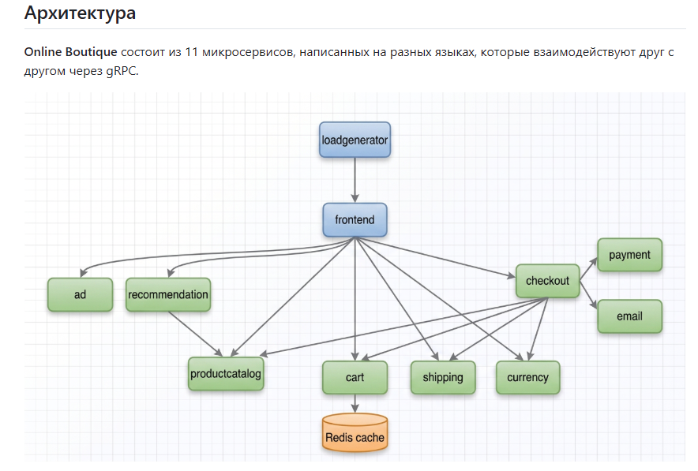](/manifests/img/Struct-app.png)

## ✨ Разработка в minikube - kubernetes-project-dev
### 1. Поднимаем minikube и необходимые аддоны
minikube start --driver=docker --nodes=3 --memory=3072 --cpus=2
minikube addons enable metrics-server
kubectl config use-context minikube

### 🔥 Увеличение лимитов inotify instances/watches на нодах
minikube ssh
sysctl fs.inotify.max_user_instances fs.inotify.max_user_watches
ulimit -n
sudo sysctl -w fs.inotify.max_user_instances=1024
sudo sysctl -w fs.inotify.max_user_watches=1048576
sudo sysctl -w fs.file-max=262144
echo -e "fs.inotify.max_user_instances=1024\nfs.inotify.max_user_watches=1048576" | sudo tee /etc/sysctl.d/99-promtail.conf
sudo sysctl --system
exit

#### 🌟 ./scripts/minikube.sh (chmod +x kubernetes-project/scripts/minikube.sh)

### 2. Создаем namespace:
kubectl create ns monitoring
kubectl create ns logging
kubectl create ns tracing
kubectl create ns boutique
kubectl create ns asm-ingress
kubectl create ns istio-system

### 3. Установливаем платформенные компоненты Helm
helm repo add grafana https://grafana.github.io/helm-charts
helm repo add prometheus-community https://prometheus-community.github.io/helm-charts
helm repo add jaegertracing https://jaegertracing.github.io/helm-charts
helm repo add istio https://istio-release.storage.googleapis.com/charts
helm repo add kiali https://kiali.org/helm-charts
helm repo update

### ⛵️ 4. Установка Istiod
#### Вручную
export ISTIO_VERSION=1.24.1
curl -L https://istio.io/downloadIstio | sh -
cd istio-1.24.1
export PATH=$PWD/bin:$PATH
istioctl install --set profile=demo -y

#### Удаляем Istio
istioctl uninstall --purge -y

#### Через helm
helm install istio-base istio/base -n istio-system --create-namespace
helm install istiod istio/istiod -n istio-system --wait
helm install asm-ingressgateway istio/gateway -n asm-ingress --create-namespace

### 🚀 5. Устанавливаем Jaeger

kubectl label namespace tracing istio-injection=enabled

helm upgrade --install jaeger jaegertracing/jaeger \
  --namespace tracing \
  -f helm/tracing/values-jaeger.yaml

#### удаление helm uninstall jaeger jaegertracing/jaeger -n tracing

### Jaeger: kubectl port-forward -n tracing service/jaeger 16686:16686 переход на http://localhost:16686

[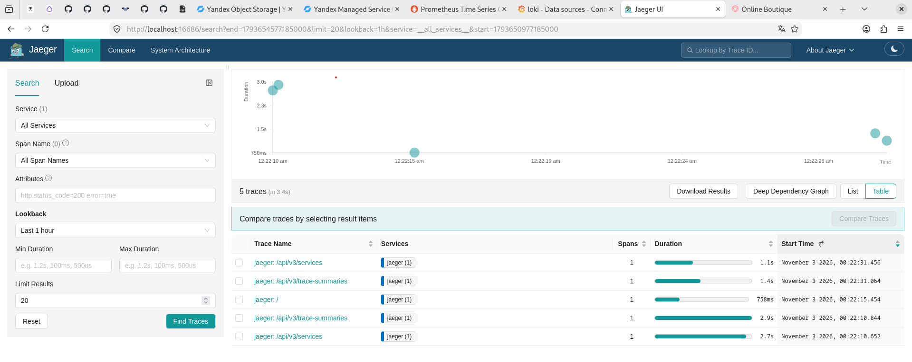](/manifests/img/Jaeger.png)

### 🚀 6. Устанавливаем мониторинг (Prometheus + Grafana + Alertmanager)
#### 💡 Включаем ServiceMonitor, чтобы потом подхватывать метрики приложения

kubectl label namespace monitoring istio-injection=enabled

helm upgrade --install kube-prometheus-stack prometheus-community/kube-prometheus-stack \
  --namespace monitoring \
  -f helm/monitoring/values-prometheus.yaml

#### удаление helm uninstall kube-prometheus-stack -n monitoring

[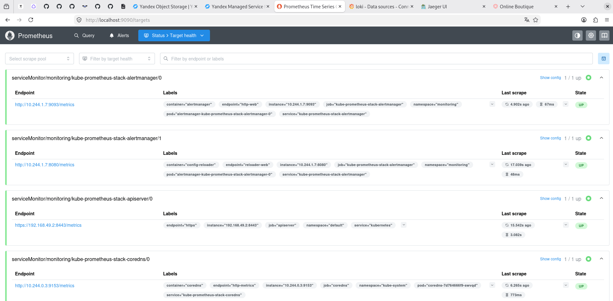](/manifests/img/Prometheus.png)

### 💡 «Для сбора метрик с микросервисов Online Boutique применён гибридный подход:
#### Frontend (HTTP) — метрики собираются напрямую через ServiceMonitor в Prometheus.
#### gRPC‑сервисы (cart, payment, shipping и др.) — не экспортируют HTTP‑метрики напрямую. Вместо этого они отправляют трейсы и логи в OpenTelemetry Collector, который агрегирует данные и предоставляет метрики для Prometheus. Это позволяет избежать установки экспортеров в каждый gRPC‑под и обеспечивает единообразие сбора телеметрии.»

### Prometheus: kubectl port-forward -n monitoring svc/kube-prometheus-stack-prometheus 9090:9090 переход на http://localhost:9090/query
### Grafana: kubectl port-forward -n monitoring svc/kube-prometheus-stack-grafana 3000:80 переход на http://localhost:3000 (admin)
### Alertmanager: kubectl port-forward -n monitoring svc/kube-prometheus-stack-prometheus 9093:9093 переход на http://localhost:9093

[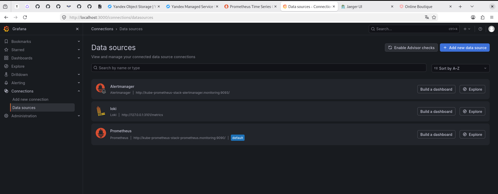](/manifests/img/Grafana.png)

### 🚀 7. Устанавливаем логирование (Loki + Promtail)

kubectl label namespace logging istio-injection=enabled

#### Loki
helm upgrade --install loki helm/logging/loki-chart \
  --namespace logging \
  --create-namespace \
  -f helm/logging/loki-chart/values.yaml

#### удаление helm uninstall loki -n logging

helm upgrade --install promtail grafana/promtail \
  --namespace logging \
  --set loki.serviceName=loki \
  -f helm/logging/values-promtail.yaml

#### удаление helm uninstall promtail -n logging

[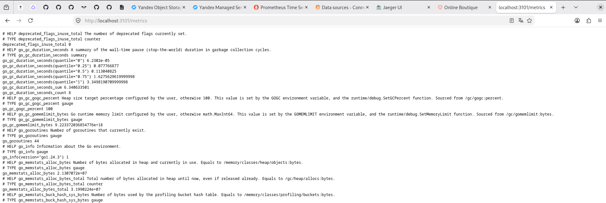](/manifests/img/Loki_Promtail.png)

### Loki+Promtail: kubectl --namespace logging port-forward daemonset/promtail 3101 переход на http://localhost:3101/metrics

### 🔥 6. Устанавливаем приложение Online Boutique by Google
[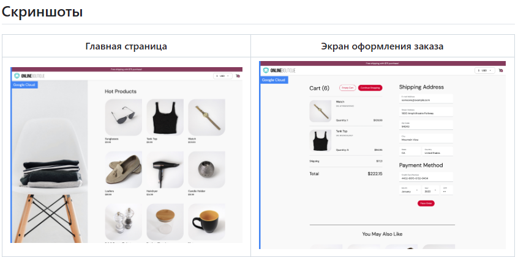](/manifests/img/Screen-app.png)

kubectl label namespace boutique istio-injection=enabled

helm install boutique ./helm/online-boutique \
  --namespace boutique --create-namespace \
  --set networkPolicies.create=true \
  --set sidecars.create=true \
  --set serviceAccounts.create=true \
  --set authorizationPolicies.create=true \
  --set frontend.externalService=true \
  --set frontend.virtualService.create=true \
  --set frontend.virtualService.gateway.name=asm-ingressgateway \
  --set frontend.virtualService.gateway.namespace=asm-ingress \
  --set frontend.virtualService.gateway.labelKey=asm \
  --values ./helm/online-boutique/values.yaml

#### удаление helm uninstall boutique -n boutique

#### Get the external IP address of the frontend:
    export SERVICE_IP=$(kubectl get svc --namespace boutique frontend-external --template "{{ range (index .status.loadBalancer.ingress 0) }}{{.}}{{ end }}")
    echo http://$SERVICE_IP
#### Get the external IP address of the ingress gateway:
    export SERVICE_IP=$(kubectl get svc --namespace asm-ingress asm-ingressgateway --template "{{ range (index .status.loadBalancer.ingress 0) }}{{.}}{{ end }}")
    echo http://$SERVICE_IP

[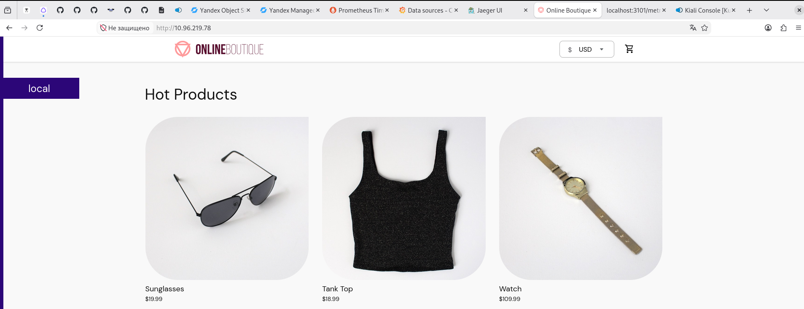](/manifests/img/Screen-dev.png)

### 🔎 7. Добавление правил и политик
kubectl apply -f manifests/frontend-asm-ingress.yaml
kubectl apply -f manifests/istio-metrics.yaml
kubectl apply -f manifests/mon-prometheusrule.yaml 
kubectl apply -f manifests/mon-networkpolicy.yaml

### удаление правил и политик
kubectl delete -f manifests/frontend-asm-ingress.yaml
kubectl delete -f manifests/istio-metrics.yaml
kubectl delete -f manifests/mon-prometheusrule.yaml 
kubectl delete -f manifests/mon-networkpolicy.yaml

### 📊 8. Устанавливаем Kiali

helm upgrade --install kiali-server kiali/kiali-server \
  -n istio-system \
  -f helm/kiali/values-kiali.yaml

#### удаление helm uninstall kiali-server -n istio-system

### Kiali: kubectl port-forward svc/kiali -n istio-system 20001:20001 переход на http://localhost:20001

[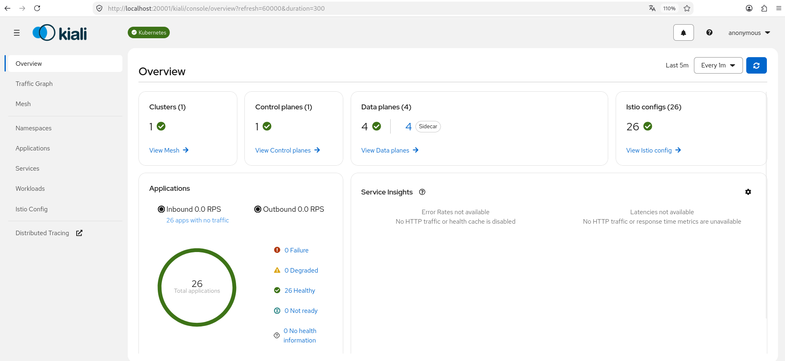](/manifests/img/Kiali-over.png)

[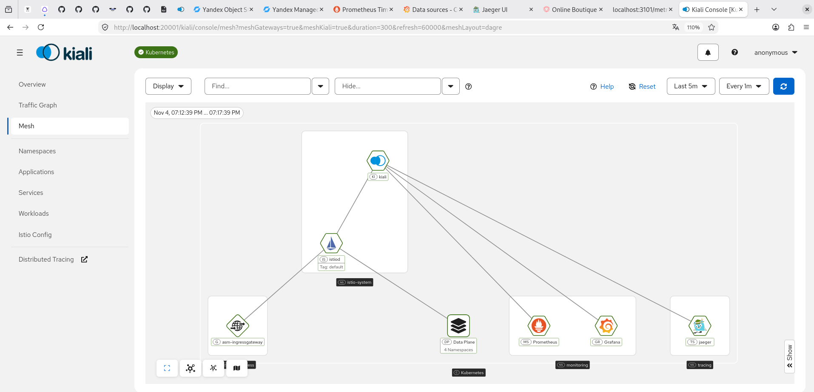](/manifests/img/Kiali.png)

### 📈 «Observability-стек дополнен Kiali — консолью управления service mesh. Kiali интегрирован с Prometheus (метрики Envoy через PodMonitor на порту 15020), Grafana (переходы на дашборды Istio) и Jaeger (распределённая трассировка через Telemetry API с extensionProvider opentelemetry). Граф трафика в Kiali отображает топологию взаимодействия микросервисов Online Boutique, health-статусы и распределение ответов по кодам.»

[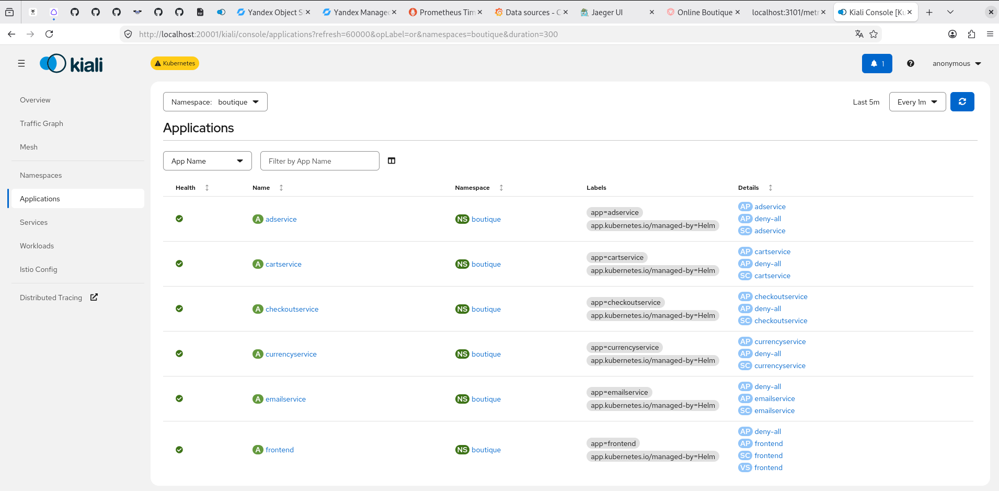](/manifests/img/Kiali-app.png)

[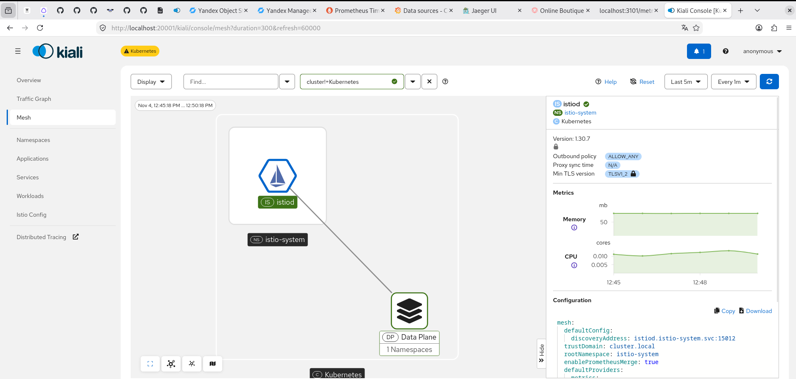](/manifests/img/Kiali-control.png)

[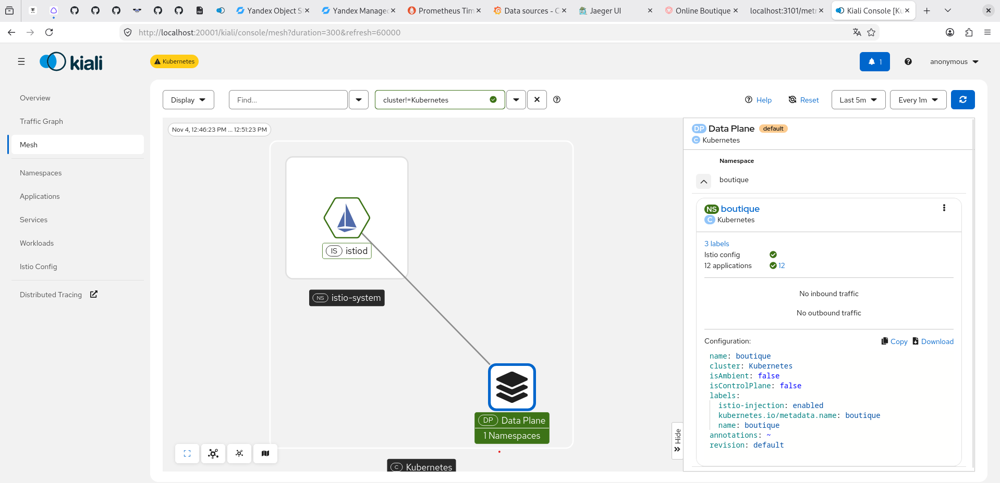](/manifests/img/Kiali-data.png)

[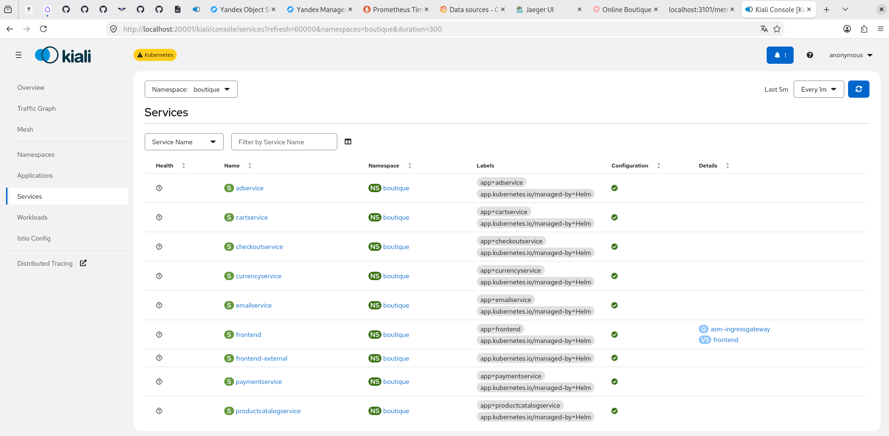](/manifests/img/Kiali-ser.png)

#### 🌟 ./scripts/deploy-all.sh (chmod +x kubernetes-project/scripts/deploy-all.sh)

### Удаление кластера:
#### 🌟 ./scripts/destroy-all.sh (chmod +x kubernetes-project/scripts/destroy-all.sh)

## 🎉 Развертывание в Yandex Cloud - kubernetes-project-prod

### 🚀 1. Terraform
#### 🌟 Установка:
cd /tmp
wget https://hashicorp-releases.yandexcloud.net/terraform/1.16.5/terraform_1.16.5_linux_amd64.zip
sudo apt install -y unzip   # если unzip ещё не стоит
unzip terraform_1.16.5_linux_amd64.zip
sudo mv terraform /usr/local/bin/
terraform -v

#### 🌟 Порядок использования:

cd terraform
terraform init         # иницилизация
terraform validate     # валидация
terraform plan         # планирование
terraform apply        # создание кластера

CLUSTER_ID=$(terraform output -raw cluster_id)
yc managed-kubernetes cluster get-credentials --id $CLUSTER_ID --external
kubectl get nodes

terraform destroy      # удаление всей инфраструктуры

### 🚀 2. ArgoCD
#### 🌟 Установка:
helm repo add argo https://argoproj.github.io/argo-helm
helm repo update

kubectl create ns argocd

helm install argocd argo/argo-cd \
  -n argocd --create-namespace

#### Доступ UI
kubectl get secret argocd-initial-admin-secret -n argocd \
  -o jsonpath="{.data.password}" | base64 -d; echo
#### Логин: admin. После первого входа сменим пароль и удалим секрет:
kubectl delete secret argocd-initial-admin-secret -n argocd

#### Добавляем CLI:
curl -sSL -o /tmp/argocd https://github.com/argoproj/argo-cd/releases/latest/download/argocd-linux-amd64
chmod +x /tmp/argocd
sudo mv /tmp/argocd /usr/local/bin/
argocd version --client

#### 🌟 Установка приложения:
kubectl apply -f argocd/boutique-app.yaml

#### Проверка:
argocd app list
argocd app get boutique      # состояние, health, последние синки
argocd app sync boutique     # ручной sync, если нужен немедленный прогон

### 🚀 3. GitLab-CI

### =============================================================
### Единый пайплайн: minikube / cloud
### DEPLOY_TARGET=minikube  -> деплой в локальный minikube через scripts/
### DEPLOY_TARGET=cloud     -> Terraform (YC) + деплой платформы + ArgoCD sync
### =============================================================

#### Переменная CI/CD      	                
#### YC_TOKEN	              masked, protected	      токен Yandex Cloud
#### YC_CLOUD_ID	          masked	                ID облака
#### YC_FOLDER_ID           masked	                ID каталога
#### CLUSTER_NAME           online-boutique-project имя кластера
#### NODE_COUNT	            3                       количество узлов
#### ARGOCD_ADMIN_PASSWORD	masked	                пароль admin ArgoCD облачного кластера

#### 🌟 Запуск и проверка
##### 1. Коммит пайплайна
git add .gitlab-ci.yml
git commit -m "ci: unified pipeline with minikube/cloud targets"
git push

##### 2. Прогон в minikube: Run pipeline, DEPLOY_TARGET=minikube
##### 3. Прогон в облако: Run pipeline, DEPLOY_TARGET=cloud

##### после зелёного пайплайна в cloud:
kubectl config get-contexts        # контекст облачного кластера активен
argocd app get boutique            # Healthy + Synced